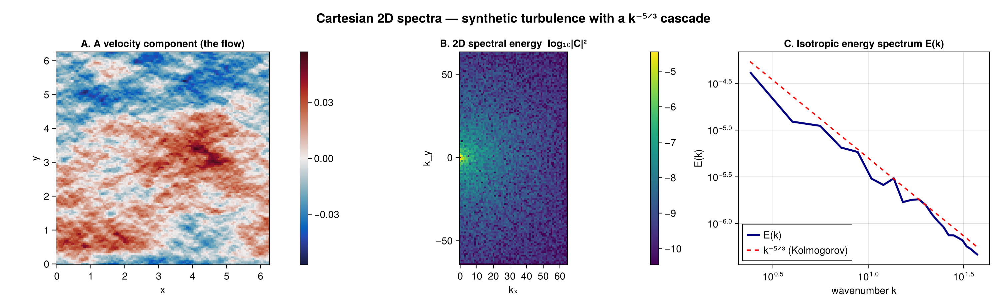
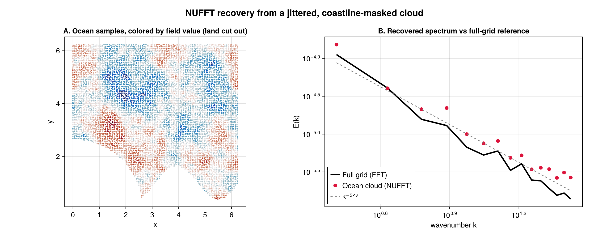
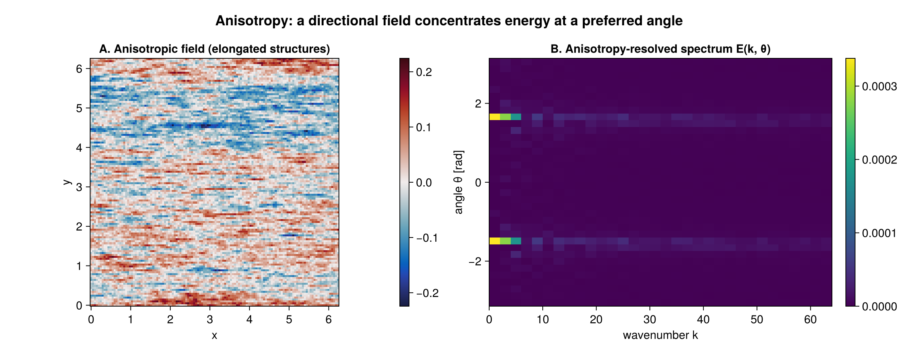
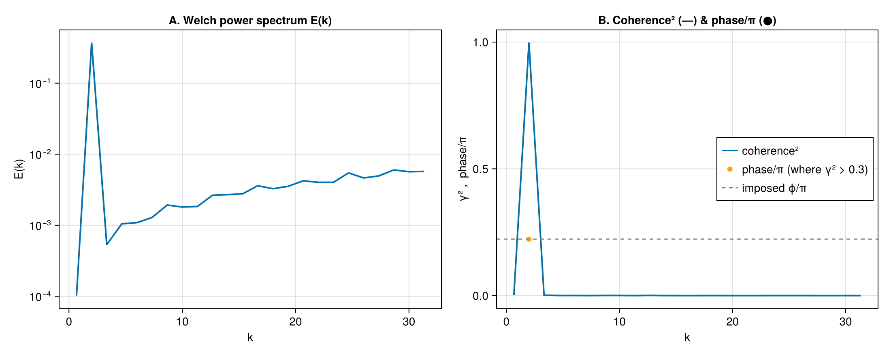
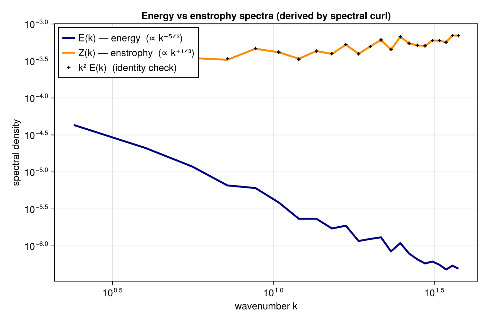
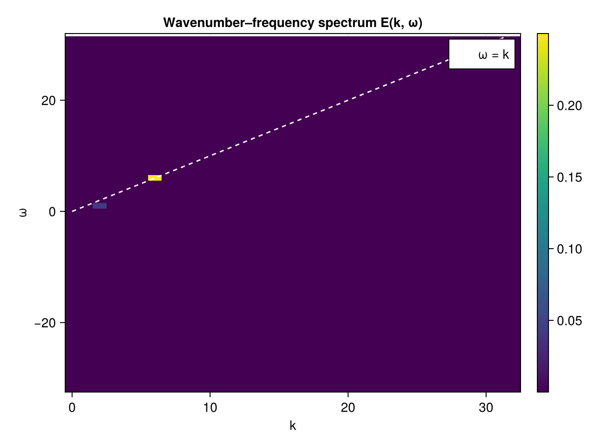
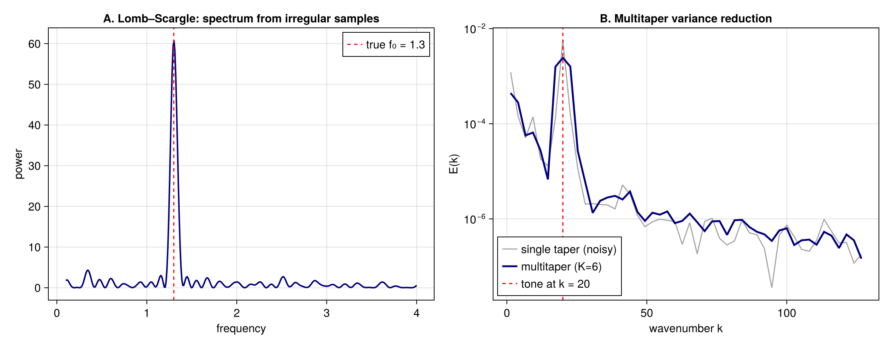
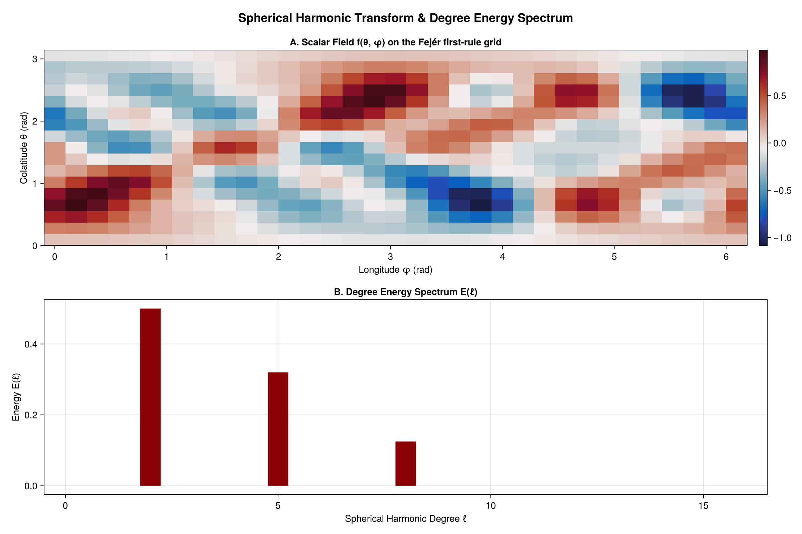
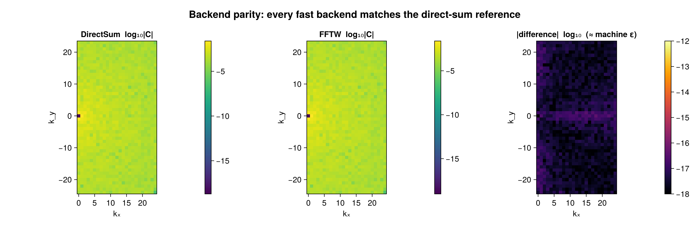

# FlowFieldSpectra.jl

*Unified, blazing-fast multi-dimensional spectral analysis and reductions for flow fields in Julia.*

[](https://github.com/jbphyswx/FlowFieldSpectra.jl/actions/workflows/CI.yml)
[](https://jbphyswx.github.io/FlowFieldSpectra.jl/dev/)
[](https://codecov.io/gh/jbphyswx/FlowFieldSpectra.jl)

`FlowFieldSpectra.jl` simplifies computing spectral coefficients, energy spectra, and spatial reductions (such as isotropic radial integration or dimension transects) across multi-dimensional grids. It supports **Cartesian** and **Spherical** coordinates on both **structured/uniform** and **unstructured/scattered** grids.

Normalization, the packed layout of a real field, non-uniform coordinate mapping and Legendre recurrences sit behind a single type-stable call: `calculate_spectrum`.

---

## Core Features

- **Unified, grid-typed interface**: one `calculate_spectrum` (and allocation-free `calculate_spectrum!`)
  for any combination of coordinates, grid types, and dimensions; the grid type defines the coordinate
  system.
- **Cartesian & spherical**: Cartesian 1D / 2D / 3D / ND transforms; Spherical Harmonic Transforms on
  the sphere. Works for any number of field components (scalar, or 1-/2-/3-component vector flows).
- **Structured & scattered grids**: uniform/rectilinear grids, and non-uniform / scattered / random
  point clouds (e.g. masked by a coastline) — recovered correctly via non-uniform transforms.
- **Library-free baseline**: the direct sum (`DirectSumSpectralBackend`) serves every grid with no
  transform library; load an FFT, NUFFT or spherical-harmonic library to run the fast `O(N log N)`
  transforms (table below).
- **Two orthogonal backend axes**: a `transform=` axis (the spectral math above) and an
  independent `execution=` axis — `SerialBackend`, `ThreadedBackend` (`using OhMyThreads`; the default
  `AutoBackend()` resolves to it once OhMyThreads is loaded and Julia has more than one thread),
  `GPUBackend` (`KernelAbstractions`: FFTs
  through the device array's `AbstractFFTs` implementation — cuFFT, rocFFT, … — the hybrid FFT/NUFFT
  composite, NonuniformFFTs on any KA device and cuFINUFFT on CUDA, the spherical transforms, and
  portable direct-sum kernels on *any* KA device), `DistributedBackend` (`Distributed`), and
  `MPIBackend` (`MPI`, incl. multi-GPU) — that compose freely.
- **Reductions**: isotropic/radial binning, transects/slices, anisotropy-resolved `E(k, θ)`,
  wavenumber–frequency `E(k, ω)`, spherical degree spectra, compensated `kᵖE(k)` and band-integrated energy.
- **Cross-analysis**: cross-/co-/quadrature spectra (flux by scale, e.g. `⟨u'w'⟩`), magnitude-squared
  coherence and phase, Welch and multitaper (DPSS) variance reduction.
- **Derived-quantity spectra**: vorticity, divergence, and enstrophy spectra via spectral differentiation
  (`Z(k) = k²E(k)` holds on incompressible 2D fields).
- **Irregular sampling**: Lomb–Scargle periodogram for unevenly-sampled series (moorings, drifters, tracks).
- **Synthesis & filtering**: first-class synthesis for spectral filtering and round-trip validation; it
  inverts the transform on a uniform periodic grid and is its adjoint under the grid's quadrature on any grid.
- **Performance**: a reusable plan for every transform, forward and synthesis, with batched trailing axes
  (build once, reuse across z/t/components) and allocation-free execution; the real-input `rfft` path for
  real fields; held spherical Legendre tables; `Float32` end to end.
- **Plotting**: `CairoMakie` extension for spectra and backend-comparison figures.

---

## Installation

Install `FlowFieldSpectra.jl` from the Julia package manager:

```julia
using Pkg
Pkg.add("FlowFieldSpectra")
```

> **Julia 1.11+.** The package uses Project.toml `[sources]`/`[workspace]` (a Julia 1.11 feature) to
> pull in the spherical backend [NUFSHT.jl](https://github.com/jbphyswx/NUFSHT.jl), which is not in
> the General registry.

---

## Extension Architecture: Unlocking Fast Paths

By default, the package runs slow-path direct sums (DFT/SHT, ``O(N \cdot M)`` complexity). To unlock ``O(N \log N)`` fast paths, simply load the corresponding package:

| Grid Type | Coordinate System | Required Library | Backend Type | Description |
|---|---|---|---|---|
| **Structured** | Cartesian (ND) | an `AbstractFFTs` implementation, e.g. `using FFTW` | `FFTSpectralBackend()` | Fast Fourier Transform through the `AbstractFFTs` interface |
| **Scattered / stretched** | Cartesian (ND) | `using NonuniformFFTs` or `using FINUFFT` | `FlowTransformBindings.NonuniformFFTsBackend()` / `FlowTransformBindings.FINUFFTBackend()` | Non-uniform Fast Fourier Transform through [FlowTransformBindings](https://github.com/jbphyswx/FlowTransformBindings.jl) |
| **Structured** | Spherical (2D) | `using FastSphericalHarmonics` | `FSHTSpectralBackend()` | Fast SHT on FastTransforms' grid: Fejér first-rule latitudes (`Fejer1Sampling`) and a periodic longitude axis of `2nlat − 1` points |
| **Scattered** | Spherical (2D) | `using NUFSHT` | `NUFSHTSpectralBackend()` | Non-uniform Fast SHT, by quadrature or least-squares fit (`analysis`) |
| **Any** | Visualization | `using CairoMakie` | (Plotting Functions) | Enclosing plotting extension |

`FFTSpectralBackend()` runs with whichever `AbstractFFTs` implementation is loaded. `AutoSpectralBackend()`
picks it where a provider's extension declares a host FFT, as FFTW's does; another implementation declares
it with a one-method extension, `_available(::_HostFFT) = true`.

---

## Quickstart: 2D Cartesian Flow Field

Below is a complete example showing how to compute and plot the 1D isotropic energy spectrum of a 2D Cartesian flow field.

```julia
using FlowFieldSpectra: FlowFieldSpectra as FFS
using FFTW: FFTW                          # activates the FFT extension
using CairoMakie: CairoMakie as Mke       # activates the plotting extension
using SpectralBackends: SpectralBackends as SB     # transform tags
using FlowGeometries: FlowGeometries as FG         # grid / geometry types

# 1. A uniform Cartesian grid — a FlowGeometries StructuredGrid over a CartesianGeometry, periodic in
#    both directions (the Fourier domain). Defined by its axes; no per-point coordinate arrays.
L = 10.0
N = 64
xs = range(0.0, L; length = N + 1)[1:N]
ys = range(0.0, L; length = N + 1)[1:N]
grid = FG.Grids.StructuredGrid(FG.Geometry.CartesianGeometry{Float64}(), xs, ys;
    topology = (FG.Grids.Periodic(), FG.Grids.Periodic()), period = (L, L))

# 2. Fields are plain N-D tensors on the grid — here two velocity components (u, v).
u = [cos(2π * 2 * x / L) + 0.5 * sin(2π * 5 * y / L) for x in xs, y in ys]   # (N, N)
v = [sin(2π * 2 * x / L) for x in xs, y in ys]

# 3. Spectral coefficients via FFTW. Passing (u, v) stacks them on a trailing component axis,
#    so `coeffs` is (N, N, 2). The grid's architecture × geometry is the coordinate system.
coeffs, ks = FFS.calculate_spectrum(grid, (u, v), (N, N); transform = SB.FFTSpectralBackend())

# 4. 1D isotropic energy spectrum, folding the 2 components (dim 3) into the kinetic energy.
k_bins, E_k = FFS.isotropic_spectrum(ks, coeffs; num_bins = 32, dims = 3)

# 5. Visualize.
fig = FFS.plot_spectrum(ks, coeffs; title = "2D Spectral Energy")
Mke.save("energy_spectrum.png", fig)
```

Construct the grid that matches your data with [FlowGeometries](https://github.com/jbphyswx/FlowGeometries.jl) —
a `StructuredGrid`/`UnstructuredGrid` over a `CartesianGeometry` (uniform → FFT, scattered → NUFFT) or a
`SphericalGeometry` (structured → SHT, scattered → NUFSHT) — and dispatch is exact. Transform tags come
from [SpectralBackends](https://github.com/jbphyswx/SpectralBackends.jl) and execution backends from
[ComputationalBackends](https://github.com/jbphyswx/ComputationalBackends.jl). For repeated transforms on
a fixed grid (e.g. each level/time of an `(x,y,z,t)` field), build a plan once with `plan_spectrum` and
reuse it via `calculate_spectrum!`.

---

## Gallery

A quick visual tour of what the package does. Each figure is generated reproducibly by
[`docs/generate_assets/generate_assets.jl`](docs/generate_assets/generate_assets.jl), and every
capability has a runnable, rendered [example in the docs](https://jbphyswx.github.io/FlowFieldSpectra.jl/dev/).

### Cartesian spectra (FFT)



*A synthetic turbulent flow, its 2D spectral energy density, and the isotropic `E(k)` — which follows the canonical Kolmogorov `k⁻⁵ᐟ³` cascade.*

### Scattered points & coastline cutout (NUFFT)



*A field sampled only at jittered "ocean" points (land masked out) is transformed with FINUFFT; the recovered spectrum tracks the full-grid reference.*

### Anisotropy-resolved spectrum `E(k, θ)`



*A directionally biased field (elongated structures, left) concentrates its energy at a preferred angle, resolved by `E(k, θ)` (right).*

### Cross-spectra, coherence & phase



*Welch-averaged power, plus magnitude-squared coherence and the recovered phase between two fields — the basis for flux-by-scale (e.g. `⟨u'w'⟩`).*

### Derived-quantity spectra (energy vs enstrophy)



*Energy `E(k) ∝ k⁻⁵ᐟ³` and enstrophy `Z(k) ∝ k⁺¹ᐟ³` via spectral differentiation; the `Z(k) = k²E(k)` identity holds exactly on an incompressible field.*

### Wavenumber–frequency spectrum `E(k, ω)`



*Time as a spectral axis: a propagating wave sits on the `ω = k` dispersion line, separating waves from a slower background.*

### Irregular sampling & windowed estimation



*Lomb–Scargle recovers a tone from unevenly-sampled data (left); multitaper (DPSS) averaging cuts the variance of a short record's spectrum (right).*

### Spherical harmonic degree spectrum



*Scalar field on a Fejér first-rule grid (left) and its energy per spherical-harmonic degree ℓ (right). Scattered nodes use the NUFSHT backend.*

### Backend parity (validation)



*DirectSum vs FFTW coefficients agree to machine precision — every fast backend is checked against the direct-sum reference.*

### Execution-axis invariance (transform × execution)


*The two backend axes are orthogonal: one FFT transform run under `SerialBackend`, `ThreadedBackend`, and `GPUBackend(KA.CPU())` returns identical spectra to machine precision — the `execution=` axis changes only where/how it runs, never the result. See [`examples/execution_backends.jl`](examples/execution_backends.jl).*

---

## Core API Reference

See the [API reference](https://jbphyswx.github.io/FlowFieldSpectra.jl/dev/api/) for the full surface.

### Spectral calculation
- `calculate_spectrum(grid, field, ms; transform=SB.AutoSpectralBackend(), execution=CB.AutoBackend(), kwargs...)`: coefficients + physical wavenumber grids. `field` is an N-D `AbstractArray` shaped `(spatial…, batch…)` — the grid fixes the leading spatial dims, every trailing dim is a preserved batch axis (components/levels/time/ensemble); a `Tuple` of equal-shaped arrays stacks them on a new trailing axis. The two backend axes are orthogonal and compose — `transform` (a `SpectralBackends` tag: which spectral math) × `execution` (a `ComputationalBackends` backend: serial/threaded/GPU/distributed/MPI).
- `calculate_spectrum!(coeffs, plan, field)` / `plan_spectrum(grid, T, ms; transform, execution, batch=())`: reusable plans over a trailing batch shape for allocation-free, copy-free (real FFT) repeated transforms.
- `synthesize(grid, coeffs, ms)`, `synthesize!(out, plan, coeffs)` / `plan_synthesis(grid, T, ms; …)`: the
  series evaluated at the grid's points (spectral filtering, round trip); the inverse of
  `calculate_spectrum` on a uniform periodic grid, its adjoint under the grid's quadrature on any grid.
- `analysis = Quadrature()` (default) or `LeastSquares()`: on a scattered sphere, NUFSHT's quadrature
  projection or its least-squares fit (`maxiter`, `rtol`); `analysis_status(plan)` returns the last call's
  `(; converged, iterations, residual)`. A fit that stops short still writes its coefficients and reports
  it there. Backends without a fit raise on `LeastSquares()`.
- `batch_chunk`: how many batch fields one library execution carries on the NUFFT and NUFSHT paths (`0`
  for the whole batch). By default a host NonuniformFFTs plan carries four, which keeps its memory
  independent of the batch; FINUFFT, device plans and NUFSHT carry the whole batch. On a stretched tensor
  grid's one-dimensional passes it is the lines per execution, four per thread by default.

### Reductions
Every reduction takes `execution` (default `CB.AutoBackend()`): `ThreadedBackend` splits its rows over
threads, `SerialBackend` runs on one and allocates nothing in place, and device coefficients are reduced on
their device.
- `isotropic_spectrum(ks, coeffs; num_bins, dims=())`: radial integration to `E(k, batch…)` (batch preserved); `dims` folds designated batch axes (e.g. vector components) into the energy.
- `transect_spectrum(ks, coeffs, dims)`: integrate out specific dimensions (e.g. a zonal spectrum).
- `anisotropic_spectrum(ks, coeffs; num_k_bins, num_θ_bins)`: anisotropy-resolved `E(k, θ)`.
- `spherical_energy_spectrum(coeffs; lmax)`: energy per spherical degree `ℓ`.
- `compensate(k, E, p)` / `band_energy(k, E, k1, k2)`: `kᵖE(k)` and band-integrated energy.

### Cross-analysis & estimation
- `cross_spectrum` / `cospectrum` / `quadspectrum`: scale-by-scale covariance (flux by scale).
- `coherence_spectrum`, `welch_power_spectrum`, `dpss`: coherence/phase and variance reduction (Welch, multitaper).
- `lomb_scargle(t, y, freqs)`: periodogram for irregularly-sampled series.

### Derived quantities
- `spectral_vorticity(ks, coeffs)` / `spectral_divergence(ks, coeffs)`: spectral-differentiation
  operators, returning the derived field's coefficients on the same wavenumber axes `ks`.

### Plotting (with `CairoMakie`)
- `plot_spectrum(ks, coeffs; title, u_idx)`: coefficient magnitude of one batch slice, a line in 1D and a heatmap in 2D.
- `compare_spectra(results; u_idx)`: several spectra side by side, `results` an iterable of `label => (coeffs, ks)`.
- `compare_spectral_analysis(input_data, results)`: `compare_spectra` with the input field plotted first.