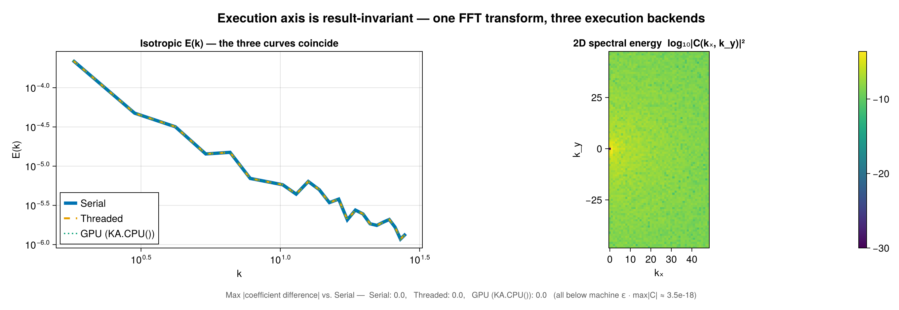

# Backends and Extensions

`FlowFieldSpectra.jl` separates spectral algorithms from library dependencies with package extensions. The core package has no compiled library dependencies such as FFTW or FINUFFT; each fast backend activates when you load its library.

Backends come in **two orthogonal axes** that compose freely — the public API takes one of each as
the `transform=` and `execution=` keywords. The tag types live in two shared packages:

- **Transform** (`SpectralBackends.AbstractSpectralBackend`) — *which spectral math*:
  `DirectSumSpectralBackend`, `FFTSpectralBackend`, `NUFFTSpectralBackend`, `FSHTSpectralBackend`,
  `NUFSHTSpectralBackend` (from [SpectralBackends.jl](https://github.com/jbphyswx/SpectralBackends.jl)).
  Covered by the matrix below.
- **Execution** (`ComputationalBackends.AbstractExecutionBackend`) — *where/how it runs*:
  `SerialBackend`, `ThreadedBackend`, `GPUBackend`, `DistributedBackend`, `MPIBackend`, `AutoBackend`
  (from [ComputationalBackends.jl](https://github.com/jbphyswx/ComputationalBackends.jl)). Covered in
  [Execution backends](@ref) below.

```julia
using SpectralBackends: SpectralBackends as SB
using ComputationalBackends: ComputationalBackends as CB
using FlowTransformBindings: FlowTransformBindings as FTB

# FFT transform, run threaded:
calculate_spectrum(grid, fields, ms; transform = SB.FFTSpectralBackend(), execution = CB.ThreadedBackend())
# Fast NUFFT on a CUDA GPU (cuFINUFFT):
calculate_spectrum(grid, fields, ms; transform = FTB.FINUFFTBackend(), execution = CB.GPUBackend(CUDABackend()))
```

The NUFFT library tags, `FTB.FINUFFTBackend()` and `FTB.NonuniformFFTsBackend()`, belong to
[FlowTransformBindings.jl](https://github.com/jbphyswx/FlowTransformBindings.jl), which binds both
libraries for the whole package stack.

---

## The default: `AutoSpectralBackend`

`transform` defaults to `AutoSpectralBackend()`, which picks the fastest transform the grid admits among
the extensions you have loaded. It only ever selects a backend computing the **same** coefficients — an
FFT is exact against the direct sum, and a NUFFT or NUFSHT matches it to its requested tolerance — and it
checks each backend's precondition first, so the transform it names always applies:

| grid | Auto selects | precondition |
| :--- | :--- | :--- |
| uniform structured Cartesian | `FFTSpectralBackend()` | `ms[d] == size(grid, d)` on every axis; a host FFT provider (`using FFTW`) |
| uniform in some directions, stretched in others | `FFTSpectralBackend()` (hybrid) | axis 1 uniform; the FFT provider (`using FFTW`, or the device's under `GPUBackend`) + a NUFFT provider |
| nonuniform structured / scattered / curvilinear Cartesian | a NUFFT provider | `using NonuniformFFTs` or `using FINUFFT` |
| FastTransforms' sphere | `FSHTSpectralBackend()` | Fejér first-rule latitudes (`Fejer1Sampling`), a periodic longitude axis of `2nlat − 1` points, `ms` the grid's own size; `using FastSphericalHarmonics` |
| any other spherical grid | `NUFSHTSpectralBackend()` | `using NUFSHT` |
| nothing loaded for it | `DirectSumSpectralBackend()` | warns once, naming the package to load |

Each precondition is read from the grid's types and exact sizes. A host FFT provider is one whose
extension declares it: FFTW's does, and another `AbstractFFTs` implementation takes a one-method
extension, `FlowFieldSpectra._available(::FlowFieldSpectra._HostFFT) = true`. An explicit
`transform = FFTSpectralBackend()` runs with whichever `AbstractFFTs` implementation is loaded.

`calculate_spectrum!(coeffs, grid, field, ms)` resolves `transform` by the same rules. The direct sum
writes `coeffs` directly, and every library transform runs through a plan built for the call.
`plan_spectrum` holds a reusable plan for every transform, the direct sum included.

## Backend Selection Matrix (transform axis)

To choose explicitly, match the grid structure (structured vs. scattered/non-uniform) and coordinate system (Cartesian vs. Spherical):

| Coordinate System | Grid Structure | Baseline Backend | Fast Backend | Required Library |
| :--- | :--- | :--- | :--- | :--- |
| **Cartesian** | Uniform / Regular | `DirectSumSpectralBackend()` | `FFTSpectralBackend()` | an `AbstractFFTs` implementation (`using FFTW`) |
| **Cartesian** | Uniform in some directions, stretched in others | `DirectSumSpectralBackend()` | `FFTSpectralBackend()` (hybrid) | an `AbstractFFTs` implementation + a NUFFT provider |
| **Cartesian** | Nonuniform tensor grid (all axes stretched) | `DirectSumSpectralBackend()` | `FTB.NonuniformFFTsBackend()` / `FTB.FINUFFTBackend()` | `using NonuniformFFTs` / `using FINUFFT` |
| **Cartesian** | Scattered / Unstructured | `DirectSumSpectralBackend()` | `FTB.NonuniformFFTsBackend()` / `FTB.FINUFFTBackend()` | `using NonuniformFFTs` / `using FINUFFT` |
| **Cartesian** | Curvilinear (`CurvilinearGrid`) | `DirectSumSpectralBackend()` | `FTB.NonuniformFFTsBackend()` / `FTB.FINUFFTBackend()` | `using NonuniformFFTs` / `using FINUFFT` |
| **Spherical** | Structured (FastTransforms' Fejér first-rule grid) | `DirectSumSpectralBackend()` | `FSHTSpectralBackend()` | `using FastSphericalHarmonics` |
| **Spherical** | Iso-latitude rings (HEALPix, reduced Gaussian) | `DirectSumSpectralBackend()` (ring-factorized) | — | none |
| **Spherical** | Scattered / Unstructured / panel pixelizations | `DirectSumSpectralBackend()` | `NUFSHTSpectralBackend()` | `using NUFSHT` |
| **Spheroid** | any surface `(λ, φ)` grid | `DirectSumSpectralBackend()` | `NUFSHTSpectralBackend()` | `using NUFSHT` |

### Spheroid grids

A spherical harmonic is orthonormal over *directions*, and a `SpheroidGeometry` stores the **geodetic**
latitude — which is not the colatitude of the direction its node lies in (the two differ by up to ~0.19°
at mid-latitudes on Earth's ellipsoid). Each node is therefore embedded through the geometry's own
`geodetic_to_cartesian` and its geocentric direction read back, and the grid's own area measure supplies
the quadrature. What you get is the **surface** expansion of the field, as a geodetic field expansion
uses. The spheroid's radius varies with latitude; that radial dependence belongs to the solid-harmonic
expansion, which this package does not implement.

Because a spheroid is a surface of revolution, the direction does not depend on longitude, so a
structured spheroid grid's latitude rows remain iso-latitude and it takes the ring-factorized path. A
grid carrying height as a third direction is not the domain of a surface expansion and raises; build the
surface grid and pass the levels as trailing batch dims.

### Curvilinear grids

A `CurvilinearGrid` stores one coordinate array per direction holding a value per cell, so `x = x(i,j)`
and `y = y(i,j)` each depend on both indices and the phase `exp(-i(kₓx + k_y y))` admits no factorization
into a product over axes. (A `StructuredGrid` stores one axis per direction, which is where its separable
per-axis passes come from.) A curvilinear grid therefore transforms as a **point cloud**: every path a
node cloud takes serves it — the direct sum on any execution backend, both NUFFT providers one-shot and
through `plan_spectrum`, both inverses, and the Distributed/MPI point partition. A curvilinear grid over a
*spherical* geometry takes the per-point spherical projection, since it declares no iso-latitude
structure.

### Spherical layout routing

The spherical transform picks its algorithm from `FlowGeometries.Grids.ring_structure(grid)`, which
reports whether the grid's cells form complete latitude rows, iso-latitude rings, or neither. A masked
tensor grid, or one over a spheroid, takes the ring path:

| layout | grids | algorithm | cost |
| :--- | :--- | :--- | :--- |
| tensor product | `StructuredGrid` (Gauss–Legendre, Fejér first rule, Driscoll–Healy, lat–lon) | longitude DFT on the shared `λ` axis, then a θ-Legendre contraction | `O(nlat·L²)` |
| iso-latitude rings | `HEALPixGrid`, `RingGrid` (reduced/octahedral Gaussian), a masked `StructuredGrid` | longitude sum per ring over its own `nlon` points, each at its own quadrature weight, then the same θ contraction over rings | `O(N·L + nrings·L²)` |
| point cloud | `UnstructuredGrid`, `CubedSphereGrid`, `IcosahedralGrid`, `YinYangGrid`, Fibonacci nodes | per-point projection | `O(N·L²)` |

Whether a grid's quadrature is *exact* at its stated band limit is also a declared trait,
`admits_exact_bandlimited_quadrature`: true for Gauss–Legendre, Driscoll–Healy and the reduced Gaussians,
**false** for Fejér's first rule (whose weights support analysis only to `lmax ≈ (nlat−1)/2`) and for
the equal-area pixelizations. Use a Gauss–Legendre grid when analysis must be exact at the band limit.

Single-harmonic round trips at each sampling's own band limit:

| sampling | `nlat` | `bandlimit` | exact by trait | round trip |
| :--- | :--- | :--- | :--- | :--- |
| Gauss–Legendre | 8 / 12 | 7 / 11 | yes | 2.0e-15 / 1.2e-15 |
| Driscoll–Healy | 12 | **5** | yes | 2.9e-16 |
| Fejér first rule | 8 | 7 | no | 1.2e-01 |

**Degrees are checked against the sampling.** `ms[1] - 1` is the requested degree, and a sampling with a
band-limit relation (`SphericalSampling.has_bandlimit`) states what its latitude count supports through
`SphericalSampling.bandlimit`. That relation varies by sampling: Driscoll–Healy's is `nlat÷2 - 1` where
Gauss–Legendre's and Fejér's first rule's are `nlat - 1`; a lat–lon grid or an equal-area pixelization
states none. Asking for a higher degree emits one warning naming the limit and still returns the
coefficients.
`McEwenWiauxSampling` has no implemented latitude quadrature upstream and
raises.

---

## Detailed Backend Profiles

### `DirectSumSpectralBackend`
- **Use Case**: Reference calculations, small grids, or zero-dependency runs.
- **Mathematical Method**: Direct Discrete Fourier Transform (DFT) summation or Spherical Harmonic Transform (SHT) direct integration via Legendre recurrence relations.
- **Complexity**: ``O(N \cdot M)`` on a point set, where ``N`` is the number of grid nodes and ``M`` is the
  number of spectral modes. A tensor grid's forward and synthesis each take one dense matrix product per
  axis, ``O(N \cdot \sum_d m_d)``.
- **Dependencies**: None.

### `FFTSpectralBackend`
- **Use Case**: Traditional uniform Cartesian grids (e.g. models on regular grids), and grids that are
  uniform in some directions and stretched in others (e.g. uniform in `x`/`y`, stretched in `z`).
- **Mathematical Method**: Fast Fourier Transform (FFT) through the `AbstractFFTs` interface, FFTW or any
  other implementation. Uniformity is read **per axis** from the axis type
  (`FlowGeometries.Axes.spacing_trait`: a range axis is uniform). A grid uniform in every direction takes
  the pure FFT. A grid uniform in only some directions takes a **hybrid**
  transform: one FFT across all the uniform axes, then a 1-D type-1 NUFFT along each stretched axis, with
  every other spatial and batch dimension carried as that pass's batch. Axis 1 must be uniform; where it
  is stretched, use a NUFFT backend, whose separable path transforms every axis.
  `synthesize` and `plan_synthesis` invert the same split: a backward FFT over the uniform axes and a
  type-2 NUFFT along each stretched one, over the coefficient box a real field's packed half covers.
- **Complexity**: ``O(N \log N)`` uniform; hybrid pays the NUFFT only along the stretched axes.
- **Planning**: under FFTW, `plan_spectrum` and `plan_synthesis` plan with `MEASURE`, for a plan held
  across many executions; `measure = false` takes `ESTIMATE`. A one-shot `calculate_spectrum`,
  `calculate_spectrum!` or `synthesize` plans with `ESTIMATE`. Another provider plans with its own
  defaults.
- **Dependencies**: an `AbstractFFTs` implementation (`using FFTW`). The hybrid also needs a NUFFT
  provider for its stretched axes (`using NonuniformFFTs` or `using FINUFFT`); choose it with
  `nufft = FTB.NonuniformFFTsBackend()`, or leave the default, which takes NonuniformFFTs when loaded and
  FINUFFT otherwise.

```julia
# uniform in x, stretched in z: FFT along x, 1-D NUFFT along z
grid = FG.Grids.StructuredGrid(FG.Geometry.CartesianGeometry{Float64}(),
    range(0, 2π; length = Nx + 1)[1:Nx],      # an AbstractRange ⇒ uniform
    stretched_z;                              # a Vector ⇒ stretched
    topology = (FG.Grids.Periodic(), FG.Grids.Periodic()), period = (2π, 2π))
coeffs, ks = FFS.calculate_spectrum(grid, f, (Nx, Nz); transform = SB.FFTSpectralBackend())
```

### NUFFT — `FTB.FINUFFTBackend` / `FTB.NonuniformFFTsBackend`
- **Use Case**: Scattered spatial points in Cartesian coordinates (e.g. ship tracks, sensor arrays, float data),
  nonuniform tensor grids and curvilinear grids.
- **Mathematical Method**: Non-Uniform Fast Fourier Transform, type 1 forward and type 2 for the synthesis.
  A point set takes one `D`-dimensional transform. A nonuniform tensor grid takes `D` one-dimensional passes,
  axis by axis, in both directions; a real field's passes after the first run on the `k₁ ≥ 0` half.
  `SpectralBackends.NUFFTSpectralBackend` names no library; pass a FlowTransformBindings tag as
  `transform=`:
  - **`FTB.NonuniformFFTsBackend()`** — via `NonuniformFFTs.jl` (`using NonuniformFFTs`). A real field takes
    its real-data plan, whose oversampled grid holds the modes at `+m_d/2` the widened coefficient box
    adds; its synthesis runs the same plan's real type 2, those modes written back into the oversampled
    grid. A one-dimensional pass asks for `m_d` modes and reads or writes `+m_d/2` the same way.
  - **`FTB.FINUFFTBackend()`** — via `FINUFFT.jl` (`using FINUFFT`; GPU via cuFINUFFT with `using CUDA`). A
    real field takes complex strengths with one extra axis-1 mode, so each mode at `+m_d/2` is a conjugate
    read; a one-dimensional pass asks for the box's `m_d + 1` modes.
- **Tolerance**: `eps=` is the requested relative accuracy; the default is
  `FlowTransformBindings.default_tolerance`, `1e-9` in `Float64` and `1e-6` in `Float32`.
- **Planning**: a host NonuniformFFTs plan held by `plan_spectrum` or `plan_synthesis` plans its FFT with
  FFTW's `MEASURE`, and a one-shot with `ESTIMATE`; a tag naming flags,
  `FTB.NonuniformFFTsBackend(; fftw_flags = …)`, is planned as given. FINUFFT plans with its own default.
- **Batches**: `batch_chunk` is how many batch fields one library execution carries (`0` for the whole
  batch). A host NonuniformFFTs plan carries four by default, which keeps its memory independent of the
  batch; FINUFFT and device plans carry the whole batch. In the one-dimensional passes of a tensor grid
  and of the hybrid composite it is the lines per execution: four by default on the host, where each
  thread runs its own single-threaded library plan, and every line at once on a device.
- **Complexity**: ``O(N \log N + M \log(1/\epsilon))``.
- **Dependencies**: `using NonuniformFFTs` and/or `using FINUFFT`. Both may be loaded at once.

### `FSHTSpectralBackend`
- **Use Case**: On the host, FastTransforms' own grid: Fejér first-rule latitudes (`Fejer1Sampling`) and a
  periodic longitude axis of `2nlat − 1` points, either direction, any origin. On a `GPUBackend`, any
  structured sphere whose longitude axis is periodic (`FlowGeometries.Axes.PeriodicUniformAxis`), with the
  latitude quadrature of its `sampling`.
- **Mathematical Method**: Fast Spherical Harmonic Transform via `FastSphericalHarmonics.jl` on the host;
  on a device, a longitude FFT through `AbstractFFTs` and a Legendre kernel.
- **Complexity**: ``O(L^3)`` or ``O(L^2 \log L)``, where ``L`` is the maximum degree (`lmax`).
- **Dependencies**: Requires `using FastSphericalHarmonics`.

### `NUFSHTSpectralBackend`
- **Use Case**: Unstructured grids on the sphere (e.g., geodesic grids, scattered ocean stations, planetary orbit tracking).
- **Mathematical Method**: Non-Uniform Fast Spherical Harmonic Transform via `NUFSHT.jl`.
- **Complexity**: ``O(M \log M + N \log(1/\epsilon))`` (where ``M`` is number of modes, ``N`` is number of points).
- **Dependencies**: Requires `using NUFSHT`.
- **Note on Coefficient Recovery**: Because scattered points are unstructured, the quadrature projection (`analysis = Quadrature()`, the default) is not the exact inverse. `analysis = LeastSquares()` fits the coefficients to the scattered data by LSMR least squares, bounded by `maxiter` and `rtol`; `analysis_status(plan)` reports `(; converged, iterations, residual)` for the last call, and a fit that stops short still writes its coefficients. On a masked grid, `inactive = ZeroFill()` (the default) fits the field extended by zero over every node, and `inactive = Exclude()` fits the active nodes as their own point set; neither reads a masked value.
- **NUFFT engine**: `nufft=` picks the NUFFT library NUFSHT runs, `FlowTransformBindings.NonuniformFFTsBackend()` or `FlowTransformBindings.FINUFFTBackend()`; both take real strengths for a real field. The default `AutoSpectralBackend()` takes NonuniformFFTs when it is loaded and FINUFFT when only it is. A reusable plan (`plan_spectrum` + `calculate_spectrum!`) presets the points, the NUFSHT plan and the LSMR workspace once for a fixed point set.

---

## Execution backends

The execution axis chooses *where and how* the chosen transform runs; it is independent of the
transform axis. Defaults to `AutoBackend()`.

| Execution backend | Required library | Notes |
| :--- | :--- | :--- |
| `SerialBackend()` | none | Single-threaded CPU (always available). |
| `ThreadedBackend()` | `using OhMyThreads` | Multithreaded CPU: parallelises the direct sum over a point set or a sphere, one-shot and plan alike, and the reductions over rows of the coefficients; builds the FFT plans (FFTW's thread count) and a point set's NUFFT library plan on `Threads.nthreads()` threads, and on one thread under `SerialBackend()`. The one-dimensional NUFFT passes of a stretched tensor grid and of the hybrid composite run one task per thread, each with its own single-threaded library plan. `NUFSHTSpectralBackend` builds its plan on the same thread count, and `FSHTSpectralBackend` runs FastTransforms at it. |
| `GPUBackend(dev)` | `using KernelAbstractions` (+ vendor pkg) | GPU execution on the KernelAbstractions device `dev` (see the GPU table below). |
| `DistributedBackend(inner)` | `using Distributed` | Splits work across worker processes, each running `inner` locally. Parametric, e.g. `DistributedBackend(ThreadedBackend())`. Requires `addprocs` + `@everywhere using FlowFieldSpectra`. |
| `MPIBackend(inner)` | `using MPI` | Splits work across MPI ranks, each running `inner` locally; partials combined with `MPI.Allreduce!`. `MPIBackend(GPUBackend(dev))` targets a multi-GPU cluster. Launch under `mpiexec`. |
| `AutoBackend()` | — | Picks `ThreadedBackend` when OhMyThreads is loaded and `Threads.nthreads() > 1`, else `SerialBackend`. Never auto-selects GPU/Distributed/MPI (those need explicit context). |

Point-partitionable transforms (`DirectSumSpectralBackend`, the NUFFT backends, and
`NUFSHTSpectralBackend` in projection mode) distribute over the point/sample axis and sum the complex
coefficients. Array inputs to `FFTSpectralBackend` and `FSHTSpectralBackend` distribute over the
batch/field axis.

An FFT on a `FlowGeometries.Decomposition.AbstractSplitGrid` transforms one uniform periodic Cartesian
field across its processes. Each local FFT runs along an axis held whole, with distributed transposes
between layouts. Real fields return the packed half spectrum; complex fields return the full spectrum,
both normalized by the total cell count. Trailing batch axes stay with each spatial block.

```julia
analysis = FFS.plan_spectrum(split, Float64; batch = (), measure = false)
coefficients = FFS.allocate_coefficients(analysis)
ks = FFS.calculate_spectrum!(coefficients, analysis, field)

synthesis = FFS.plan_synthesis(analysis)
reconstructed = FFS.allocate_field(synthesis)
FFS.synthesize!(reconstructed, synthesis, coefficients)
```

Here `field` is a FlowGeometries split field on `split`, built with a `DistributedBackend` or an
`MPIBackend`. MPI transposes require `using PencilArrays`. The forward and inverse share their block
buffers and local FFT plans and execute sequentially. Consecutive stages on the same layout reuse one
coefficient buffer. Caller-allocated coefficients remain intact through synthesis.

The execution axis is **result-invariant**: it changes only where/how a transform runs, never the
answer. One FFT transform under `SerialBackend`, `ThreadedBackend`, and `GPUBackend(KA.CPU())`
returns identical coefficients (to machine ε):



### GPU transforms on any KernelAbstractions device

`GPUBackend{B}` is parametric on the KernelAbstractions device object `B`. Data is staged to that
device (`KA.allocate` + `copyto!`), and the transform runs there:

- **`FFTSpectralBackend`** is device-generic through `AbstractFFTs.plan_fft`, which dispatches on the
  device *array type*: CUFFT on a `CUDABackend` (`CuArray`), rocFFT on a `ROCBackend` (`ROCArray`), and
  FFTW on `KA.CPU()` (plain `Array`). Requires `using KernelAbstractions` + the FFT provider for your
  device (`FFTW` for CPU arrays, `CUDA` for CUDA, `AMDGPU` for ROCm). A grid uniform in some directions
  and stretched in others takes the hybrid composite on the device: that FFT over the uniform axes and a
  device NUFFT along each stretched one, forward and synthesis, one-shot and through `plan_spectrum` /
  `plan_synthesis`.
- **`DirectSumSpectralBackend`** uses the portable KernelAbstractions direct-sum kernels on any KA device,
  for the forward and the synthesis, one-shot and through `plan_spectrum` / `plan_synthesis`.
- **`FTB.FINUFFTBackend`** takes `CuArray` nodes through cuFINUFFT (`using CUDA, FINUFFT`) and host
  arrays, which `KA.CPU()` allocates, through FINUFFT's CPU library. Nodes on any other device raise.
- **`FTB.NonuniformFFTsBackend`** is device-generic: FlowTransformBindings builds the NonuniformFFTs plan
  on the nodes' KernelAbstractions backend, and FFS gathers the packed coefficient box with
  KernelAbstractions kernels, so the same code runs on CUDA, ROCm and `KA.CPU()`.
  `DirectSumSpectralBackend` is the ``O(N M)`` portable reference.
- **Spherical**: `FSHTSpectralBackend` on a device runs its own spherical-harmonic transform and
  synthesis on a structured sphere with a periodic longitude axis of any origin and direction (a
  longitude FFT through AbstractFFTs and a Legendre kernel), the quadrature projection the direct sum
  computes; `NUFSHTSpectralBackend`
  builds NUFSHT's plan on the device; `DirectSumSpectralBackend` uses the KA spherical direct-sum kernel.

| Transform | Grid | `GPUBackend(CUDABackend())` | `GPUBackend(KA.CPU())` / other KA device |
| :--- | :--- | :--- | :--- |
| `FFTSpectralBackend` | uniform Cartesian | CUFFT (via AbstractFFTs) | FFTW on `KA.CPU()`, rocFFT on ROCm, … (via AbstractFFTs) |
| `FFTSpectralBackend` (hybrid) | uniform in some directions | CUFFT + a device NUFFT | the device's FFT + a device NUFFT |
| `FTB.FINUFFTBackend` | scattered Cartesian | **cuFINUFFT** — `using CUDA, FINUFFT` | FINUFFT on `KA.CPU()`; raises on any other device |
| `FTB.NonuniformFFTsBackend` | scattered Cartesian | NonuniformFFTs (device-generic, via `CUDA`) | NonuniformFFTs on any KA device (`KA.CPU()`, ROCm, …) |
| `DirectSumSpectralBackend` | any Cartesian | KA direct-sum kernel | KA direct-sum kernel |
| `FSHTSpectralBackend` | structured sphere, periodic longitude axis | device SHT (CUFFT + Legendre kernel) | device SHT (FFTW on `KA.CPU()`, …) |
| `NUFSHTSpectralBackend` | any spherical | NUFSHT device plan | NUFSHT device plan |
| `DirectSumSpectralBackend` | any spherical | KA spherical direct-sum kernel | KA spherical direct-sum kernel |

The device-generic FFT, direct-sum and NUFFT paths are exercised on CI via `GPUBackend(KA.CPU())`, and the
direct-sum kernels on a device array that refuses host scalar indexing. The CUDA-specific paths (CUFFT on
`CuArray`, cuFINUFFT) are validated on real CUDA hardware via the package's `gpu/` project — CI has no GPU.
